# ⚡ PocketMine-Rust (Axolotl-PM)

<p align="center">
  
</p>

<p align="center">
  <strong>Next-generation, high-performance Minecraft Bedrock & Java Edition server implemented in native Rust, featuring a PocketMine-MP 5 PHP Plugin API bridge.</strong>
</p>

<p align="center">
  <a href="https://github.com/Procatin0/pocketmine-rust/actions"></a>
  <a href="LICENSE"></a>
  <a href="#"></a>
  <a href="#"></a>
  <a href="#"></a>
  <a href="docs/wiki/"></a>
</p>

---

## 🌟 Overview / Descripción General

**PocketMine-Rust (Axolotl-PM)** is an ultra-fast, cross-platform Minecraft server engine built from the ground up in **Rust**. It eliminates the single-threaded bottlenecks and garbage collection pauses typical of traditional PHP and Java server implementations while preserving 100% compatibility with **PocketMine-MP 5** plugins and allowing **Minecraft Bedrock and Java Edition** players to play together natively without third-party proxies.

> 🇪🇸 **En español:** Servidor de Minecraft de alto rendimiento escrito en Rust nativo, con soporte simultáneo para clientes Bedrock y Java (cross-play integrado sin proxies externos) y compatibilidad con plugins de PocketMine-MP 5 en PHP 8.2.

---

## 🚀 Key Features / Características Principales

### 🎮 Native Cross-Play (Bedrock + Java)
- **Zero Proxies Required**: Built-in `java-bridge` translates packets between Minecraft Java Edition (`25565`) and the central world state on the fly.
- **Protocol Parity**: Supports modern **Minecraft Java 26.1 (Protocol 775)**, **1.21.4**, down to **1.12.2 (Protocol 340)**, alongside **Minecraft Bedrock 1.21.60 (Protocol 2225)**.
- **Cross-Platform World Events**: Block breaking sound effects and particles (`LevelEvent` 2001 & Java `world_event` 2001) synchronize seamlessly across platforms.
- **Unified Names & Nametags**: Clean nametag resolution and player-list synchronization between platforms.

### ⚡ Blazing Fast Architecture
- **Tokio Asynchronous Core**: Non-blocking network I/O for WebRTC (NetherNet), RakNet, and TCP Java listeners.
- **Rayon Parallel Chunk Generation**: Multi-threaded procedural terrain generation (<2ms per 16x384 chunk column) with Simplex noise, biomes, 3D caves, and flora populators.
- **Zero GC Spikes**: Deterministic 20.0 TPS gameloop running on a dedicated central ticker thread.
- **Two-Tier Chunk Cache**: Hot L1 memory cache and serialized L2 network payload cache shared across Bedrock and Java clients.

### 🎒 Authoritative Inventory & Crafting
- **Client-Predictive Validation**: Full atomic transactions with rollback protection against desyncs and cheats.
- **Container Sizing Parity**: Window 0 (36 Inventory), Window 120 (5 Armor slots: helmet, chest, legs, boots, body), Window 119 (1 Offhand), and Window 124 (54 UI container grid).
- **Crafting Engine**: 2x2 player grid crafting, 3x3 crafting table support (`CraftingDataPacket`), and repairable anvil mechanics (`AnvilInventory`) with XP level deductions.

### 🔌 PocketMine-MP 5 Plugin API (PHP 8.2)
- **Run Existing PM5 Plugins**: Load and run `.phar` or folder-based PocketMine-MP 5 plugins without rewriting business logic.
- **Fast IPC Bridge**: Communicates with an isolated, persistent PHP worker over lightning-fast JSON-lines streaming.
- **Event Dispatcher**: Complete event lifecycle support (`PlayerJoinEvent`, `PlayerQuitEvent`, `PlayerChatEvent`, `BlockBreakEvent`, `BlockPlaceEvent`, `PlayerMoveEvent`, etc.).

### 📊 Integrated Scoreboards & BossBars
- **No External Plugins Required**: Native support for Bedrock scoreboard packets (`0x6A`, `0x6B`, `0x6C`, `0x70`) and BossBar (`0x4A`), automatically translated to Java Edition frames.
- **Diverse BossBar**: Support for player-specific diverse titles, health percentages, and color ranges.

---

## 🏗️ Workspace Crates Architecture

The codebase is organized as a clean, modular Cargo workspace:

```text
pocketmine-rust/
├── crates/
│   ├── server-core/         # Main server loop (20 TPS), session manager, commands, permissions, inventories
│   ├── bedrock-protocol/    # High-performance Bedrock packet codecs (Protocol 2225)
│   ├── bedrock-world/       # Procedural world generation (Simplex, biomes, caves, populators) & chunk palettes
│   ├── java-bridge/         # Live Java-to-Bedrock bridge & protocol translator
│   ├── java-protocol/       # Minecraft Java Edition packet encoders & serializers (Protocols 340-775)
│   ├── php-plugin-bridge/   # PocketMine-MP 5 PHP runtime, autoloader, event dispatcher, and IPC
│   ├── nethernet-rs/        # NetherNet WebRTC/DTLS networking implementation
│   └── raklib-rs/           # RakNet UDP networking implementation for Bedrock
├── data/                    # BDS capture fixtures, canonical block states, and recipes
└── docs/                    # Architectural specs, API contracts, and comprehensive Wiki
    └── wiki/                # Step-by-step developer documentation
```

---

## 🛠️ Getting Started / Inicio Rápido

### Prerequisites
- [Rust toolchain](https://rustup.rs/) (1.80+ recommended, stable channel).
- *(Optional)* [PHP 8.2+ CLI](https://www.php.net/) if running PocketMine-MP PHP plugins.

### 1. Clone the repository
```bash
git clone https://github.com/Procatin0/pocketmine-rust.git
cd pocketmine-rust
```

### 2. Build the optimized release binary
```bash
cargo build --release -p server-core
```
The compiled binary will be placed at `target/release/server-core.exe` (or `target/release/server-core` on Linux/macOS).

### 3. Run the server
```bash
cargo run --release -p server-core
```
On first launch, default configuration files (`server.properties` and `pocketmine.yml`) are generated automatically.

### 4. Connect to the server
- **Minecraft Bedrock Edition**: Connect to `127.0.0.1:19132` (UDP)
- **Minecraft Java Edition**: Connect to `127.0.0.1:25565` (TCP)

---

## 🧪 Testing & Verification

The project enforces a **100% test pass rate** across all workspace crates with over 350 unit and integration tests:

```bash
# Test all crates across the workspace
cargo test --workspace

# Test individual modules
cargo test -p bedrock-protocol
cargo test -p java-bridge
cargo test -p server-core --lib
cargo test -p server-core --test crafting_inventory_test
cargo test -p server-core --test session_lifecycle_test
```

---

## 📖 Documentation & Wiki

Explore detailed documentation in the [`docs/wiki/`](docs/wiki/) directory:

- 📘 [01 — Introducción a la arquitectura](docs/wiki/01-introduccion.md)
- 🚀 [02 — Quickstart para crear plugins](docs/wiki/02-quickstart.md)
- 📡 [10 — Sistema de eventos y listeners](docs/wiki/10-eventos.md)
- 🛡️ [11 — Permisos y roles](docs/wiki/11-permisos.md)
- ⌨️ [12 — Comandos nativos y alias](docs/wiki/12-comandos.md)
- ⏱️ [13 — Scheduler y temporizadores](docs/wiki/13-scheduler.md)
- 🎒 [14 — Inventario, crafteo y contenedores](docs/wiki/14-inventory-crafting.md)
- 🏆 [15 — Scoreboards y BossBars](docs/wiki/15-scoreboard-bossbar.md)
- ☕ [16 — Puente con Minecraft Java](docs/wiki/16-java-bridge.md)
- 🌍 [17 — Persistencia de mundos y estados](docs/wiki/17-mundo-persistencia.md)
- 🚢 [18 — Guía de despliegue y producción](docs/wiki/18-deploy.md)

---

## 📜 License

This project is licensed under the **GNU General Public License v3.0** (GPL-3.0). See the [LICENSE](LICENSE) file for complete details.

---

<p align="center">
  Crafted with ❤️ by <a href="https://github.com/Procatin0">Procatin0</a> and contributors.
</p>
